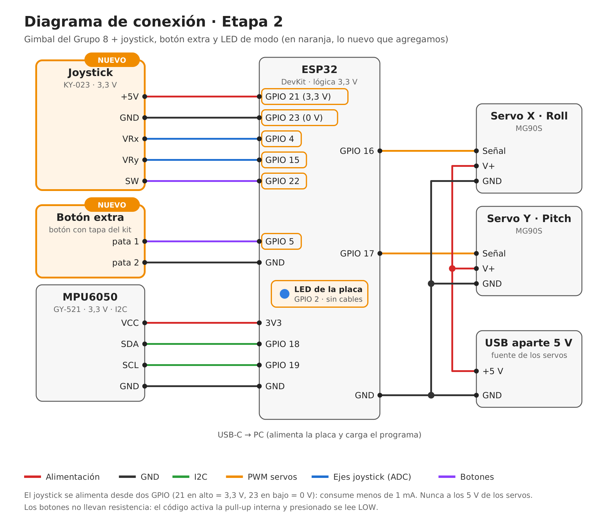

# 📌 UTN FRCU – Tecnologías para la Automatización ESP32 2026

## 👥 Team

**Team number:** 8

**Members:**
- Isaias Muga
- Santiago Poerio
- Franco Riolfo
- Federico Rojas
- Diego Venturino

## 🤖 Project Description

**Description:** A 2-axis phone stabilizer (gimbal) that corrects unwanted movement in Roll (X) and Pitch (Y). An ESP32 reads the accelerometer and gyroscope of an MPU6050 sensor, estimates the tilt by combining both sensors (complementary filter), and drives two servo motors in the opposite direction of the tilt, so the phone holder stays level even when the hand moves. The project shows that basic two-axis stabilization can be achieved with cheap, easy-to-find components.

**Technology used:** ESP32, Arduino IDE 2.x (`esp32` board package 3.3.12), MPU6050 inertial sensor, MG90S servo motors, Adafruit MPU6050 2.2.9, Adafruit Unified Sensor 1.1.15, Adafruit BusIO 1.17.4 and ESP32Servo 3.2.1 libraries, Wokwi simulation, 3D-printed parts.

## 🔩 Components Used

| Component | Quantity | Notes |
|---|---|---|
| ESP32 DevKit | 1 | Selected as "ESP32 Dev Module" in Arduino IDE. 3.3 V logic |
| MPU6050 (GY-521 module) | 1 | 3-axis accelerometer + 3-axis gyroscope, I2C communication (address 0x68) |
| MG90S servo motor | 2 | One for Roll (X axis) and one for Pitch (Y axis). 4.8 to 6 V supply |
| 3D-printed parts | 1 set | Handle and phone holder structure |
| Breadboard / Jumper wires | 1 / as needed | The breadboard distributes connections and joins the common GND |
| Power supply | 2 | ESP32: computer USB port (5 V). Servos: separate USB cable with one end cut off (only 5 V and GND kept), plugged into another USB port or a 5 V wall charger (1 A or more recommended) |

## 🛠️ Usage Instructions

### Step 1: Install and configure the software
1. Install the [Arduino IDE 2.x](https://www.arduino.cc/en/software).
2. In *File > Preferences*, add this URL to "Additional boards manager URLs":
   `https://espressif.github.io/arduino-esp32/package_esp32_index.json`
3. In *Tools > Board > Boards Manager*, install the **esp32** package by Espressif Systems.
4. In *Tools > Manage Libraries*, install **Adafruit MPU6050** (accept its dependencies: Adafruit Unified Sensor and Adafruit BusIO) and **ESP32Servo** (by Kevin Harrington). `Wire` is already included in the esp32 package.

### Step 2: Wiring / circuit setup

| Component | Component pin | Connects to |
|---|---|---|
| MPU6050 | VCC | ESP32 3.3 V |
| MPU6050 | GND | Common GND |
| MPU6050 | SDA | ESP32 GPIO 18 |
| MPU6050 | SCL | ESP32 GPIO 19 |
| Servo X (Roll) | Signal (orange) | ESP32 GPIO 16 |
| Servo X (Roll) | Positive (red) | 5 V from the servos' USB cable |
| Servo X (Roll) | Negative (brown) | Common GND |
| Servo Y (Pitch) | Signal (orange) | ESP32 GPIO 17 |
| Servo Y (Pitch) | Positive (red) | 5 V from the servos' USB cable |
| Servo Y (Pitch) | Negative (brown) | Common GND |
| Servos' USB cable | Negative | Common GND (breadboard negative rail) |
| ESP32 | GND | Common GND |
| ESP32 | USB | Computer (powers the board and uploads the program) |

### Step 3: Upload and run the sketch
1. Connect the ESP32 via USB. In *Tools*, select the **ESP32 Dev Module** board and the corresponding port.
2. Open the `.ino` file and upload the code. If the upload does not start, hold down the **BOOT** button on the board until it begins.
3. Connect the servos' power cable to another USB port or to a 5 V wall charger.
4. Open the **Serial Monitor at 115200 baud**.
5. Keep the gimbal **still and level** while the monitor shows "CALIBRANDO GIROSCOPIO" (it takes 500 samples, a few seconds). If it moves during calibration, the servos will drift on their own: reset the board with the **EN** button and repeat.

### Step 4: Expected output
- On power-up, the servos move to their center position (`CENTRO_SERVO_X = 104°`, `CENTRO_SERVO_Y = 134°`).
- The gyroscope is then calibrated and the system starts compensating for tilt: when the handle is tilted, the phone holder stays level.
- Once per second, the Serial Monitor shows the accelerometer angle, the gyroscope rate, the estimated angle and the position of each servo. Example (values are illustrative):

```
-----------------------------
Acelerometro X: 0.52° | Y: -0.31°
Gyro X: 0.02 °/s | Gyro Y: -0.05 °/s
Angulo estimado X: 0.48° | Y: -0.30°
Servo X: 104° | Servo Y: 134°
```

### Adjustable parameters

| Parameter | Value | What it controls |
|---|---|---|
| `UMBRAL_GYRO` | 1.0 °/s | Rotation rate below which the sensor is considered still |
| `TIEMPO_ESPERA` | 500 ms | Time the sensor must stay still before drift correction starts |
| `CORRECCION_DERIVA` | 0.02 | Weight of the accelerometer in each correction (higher corrects drift faster but adds noise) |
| `KI` | 0.15 | Integral gain: how fast the correction is applied each cycle (higher reacts faster but may oscillate) |
| `ZONA_MUERTA` | 0.5° | Errors smaller than this are ignored to avoid jitter |
| `LIMITE_DELTA` | 85° | Maximum compensation allowed from the center (protects the mechanism) |
| `LIMITE_PITCH_CORR` | 50° | Above this pitch, roll is not corrected with the accelerometer |
| `CENTRO_SERVO_X/Y` | 104° / 134° | Level position of each servo. They depend on the physical assembly and must be readjusted if the structure is rebuilt |

### How it works (summary)
- **Gyroscope:** measures rotation rate (°/s). It is accurate for fast movements, but integrating it accumulates error (drift).
- **Accelerometer:** measures gravity and gives an absolute angle with no drift, but it is noisy under vibration.
- **Complementary filter:** while there is movement, the gyroscope is used; when the sensor is still, the estimated angle slowly moves toward the accelerometer angle to correct drift.
- **Integral control:** each cycle, a fraction of the estimated angle (`KI × error`) is added to each servo's accumulated compensation until the error reaches 0 (level position).

[Link to a drive folder containing a demo video](https://drive.google.com/drive/folders/1WmXg_ZdmgWz-4-SYHT1wOfvsHvKkWypP?usp=drive_link)

## 🧪 Simulation

The circuit was simulated in Wokwi while the parts were being printed, so that once they arrived only the physical assembly was left.

**Wokwi project link:** [Estabilizador_Celular_GRUPO_8](https://wokwi.com/projects/477088166542319617)

**Diagram/export files:** 


## 📝 Additional Notes

**Challenges faced / technical decisions made:**
- **Gyroscope drift:** integrating the rotation rate accumulated small errors, and one of the servos ended up tilted even though the holder had not moved. It was solved with a calibration at startup (`calibrarGyro()`, which measures and subtracts the gyroscope's fixed error) and a gradual drift correction that uses the accelerometer as a reference when the system is still.
- **3D-printed parts fit:** there were differences between the 3D model dimensions and the printed parts. The dimensions were adjusted and the parts were reprinted (about one day).
- **Printing times:** the parts were printed by a person outside the group. Meanwhile, work continued on the code and the Wokwi simulation.
- **Separate servo power supply:** to prevent consumption peaks from resetting the ESP32, with a common GND between all components.
- **Dead zone and limits:** a dead zone (0.5°) and a compensation limit were added to avoid jitter and protect the mechanism.

**Current limitations:**
- The system takes the position it starts in as 0°, so it must be powered on level and kept still during calibration.
- The MG90S servos have limited torque (about 1.8 kg·cm at 4.8 V) and a USB port delivers about 500 mA: with a heavy phone the servos may shake or lose strength (a wall charger of 1 A or more is recommended).
- The servo center values depend on the physical assembly.

**Potential improvements:**
- Manual control mode with an analog joystick: pressing the button (with an interrupt and debouncing) stops stabilization, the servos go to their center position and the user moves the camera with the stick. Pressing it again resumes stabilization.

---

## 🔄 Stage 2 – Improvement

- **Team number:** 16
- **Members:**
  - Guido Mariano
  - Haffner Ignacio
  - Haffner Federico
  - Lares Danisa
  - Wulfsohn Yaco

The sections above describe Team 8's Stage 1 stabilizer and are kept as they were written. This section describes the improvement and supersedes them where they differ: the improved sketch replaces `EstabilizadorVersionFinal-Comentado.ino` in this folder.

### 🚀 Improvement Description

- **What was improved:** A **manual mode with an analog joystick** plus an **adjustable reference (setpoint)**. Pressing the joystick's push button pauses stabilization and the stick drives both servos at a speed proportional to its deflection; pressing it again returns to automatic mode **taking the angle the holder was left at as the new reference**, so the gimbal holds that framing instead of returning to level. An extra push button cycles three levels that set both the manual speed and the integral gain `KI` (short press), or restores the 0° reference and automatic mode (2-second press). The board's built-in LED indicates the current mode. This develops the improvement proposed by Team 8 in Stage 1.
- **Why:** In Stage 1 the controller's reference was fixed at 0°, so there was no way to aim the camera up or down: any deliberate tilt was corrected back to level. A manual mode on its own only stops stabilization, which does not keep a chosen framing steady, so the adjustable reference was added: the user picks the framing with the stick and the gimbal then holds it even if the hand moves, which is how commercial gimbals work. The three levels expose the trade-off between speed and stability that `KI` controls, instead of leaving it fixed at the Stage 1 value.

The original complementary filter and integral control were left untouched. Everything new is in separate functions marked `[ETAPA 2]` in the sketch, so that a later team can tell which group wrote what.

**Full Stage 2 report (Spanish):** [docs/Grupo16_Documentacion_Etapa2.pdf](docs/Grupo16_Documentacion_Etapa2.pdf), covering how the original project was reproduced, the theoretical concepts, the test results and the difficulties encountered.

### 🔩 Component Changes

| Change | Component | Quantity | Notes |
|---|---|---|---|
| Added | KY-023 analog joystick module | 1 | VRx → GPIO 4, VRy → GPIO 15 (ADC2, usable because WiFi is not used). SW → GPIO 22. Powered from two GPIOs: its `+5V` pin → GPIO 21 (driven HIGH, so it receives 3.3 V) and its `GND` pin → GPIO 23 (driven LOW) |
| Added | Momentary push button with cap | 1 | GPIO 5 and GND. Short press changes the speed/gain level; a 2-second press returns to level |
| Added | Jumper wires | 6 | Joystick and button signals, power and ground to the free ESP32 pin row on the breadboard |
| Unchanged | Built-in LED | 1 | GPIO 2, already on the board, no wiring needed. On in manual mode, off in automatic |

The MPU6050, both MG90S servos, the separate 5 V servo supply and the common GND from Stage 1 are unchanged. Neither button needs an external pull-up resistor: the firmware enables the ESP32's internal pull-ups. The joystick draws under 1 mA, which is why powering it from two GPIOs is safe; it must **never** be connected to 5 V, because the ESP32's inputs are 3.3 V. The `3V3` pin is already taken by the MPU6050, and this also keeps the joystick off the servos' 5 V rail.

**Joystick orientation.** On the finished assembly the joystick module ended up with its connector pins facing up and the ESP32 below it. In that position the stick's axes come out crossed and reversed with respect to the servos: moving the stick forward and back tilted the holder sideways, and the other way round. Rather than rewiring, this is handled in the firmware with `INTERCAMBIAR_EJES_JOY` (swaps which axis drives which servo) and the two `INVERTIR_JOY_*` constants, which are both -1 here. Anyone mounting the joystick in a different position should revisit these three constants before anything else.



### 🛠️ Updated Usage Instructions

1. **Wire the joystick and the extra button** as described in the table above and shown in the updated diagram. Do not connect the joystick to 5 V.
2. **Upload the updated firmware** from [EstabilizadorVersionFinal-Comentado.ino](EstabilizadorVersionFinal-Comentado.ino) with **ESP32 Dev Module** selected in Arduino IDE. The libraries are the same as in Stage 1 (**Adafruit MPU6050** and **ESP32Servo**); no additional libraries are required. Open the Serial Monitor at **115200 baud**.
3. **Calibrate.** Keep the gimbal still and level **and do not touch the stick** while it calibrates the gyroscope and measures the joystick's resting center. If the center reading falls outside the valid range (`CENTRO_JOY_MIN` 800 to `CENTRO_JOY_MAX` 3300), the Serial Monitor reports that the joystick is not connected and the firmware ignores it; stabilization still works as in Stage 1.
4. **Automatic mode** is the starting state, with the reference at 0°, exactly as in Stage 1.
5. **Press the stick to enter manual mode.** The LED turns on, stabilization pauses and the stick moves the servos at a speed proportional to its deflection. Released, the servos stay where they are.
6. **Press the stick again to return to automatic mode.** The angle the holder was left at becomes the new reference, so the error starts at 0, the servos do not jump, and the gimbal holds that framing from there on.
7. **Use the extra button** at any time: a short press changes the level (**1, 2 or 3 blinks** for slow, medium or fast) and holding it for **2 seconds** sets the reference back to 0° and returns to automatic mode (**4 blinks**). The firmware starts at the **medium** level.

Every mode or level change is reported on the Serial Monitor together with the new reference.

The main change is in step 6 of the `loop()`. Depending on the mode, each servo's compensation is now calculated in one of two ways:

```cpp
if (modoManual) {
  // Manual: the stick moves the servos at a proportional speed
  float velocidad = VELOCIDADES[nivelVelocidad];   // 45, 90 or 180 degrees/s
  float lecturaVRx = leerEjeJoystick(PIN_JOY_X, centroJoyX);
  float lecturaVRy = leerEjeJoystick(PIN_JOY_Y, centroJoyY);

  // With the joystick rotated, VRx drives servo Y and VRy drives servo X
  float movimientoX = INTERCAMBIAR_EJES_JOY ? lecturaVRy : lecturaVRx;
  float movimientoY = INTERCAMBIAR_EJES_JOY ? lecturaVRx : lecturaVRy;

  servoDeltaX += INVERTIR_JOY_X * movimientoX * velocidad * dt;
  servoDeltaY += INVERTIR_JOY_Y * movimientoY * velocidad * dt;
} else {
  // Automatic: corrects the difference against the chosen reference
  float errorX = anguloEstimadoX - referenciaX;
  float errorY = anguloEstimadoY - referenciaY;
  float ki = KI_POR_NIVEL[nivelVelocidad];          // 0.15, 0.30 or 0.50
  if (fabs(errorX) > ZONA_MUERTA) servoDeltaX += ki * errorX;
  if (fabs(errorY) > ZONA_MUERTA) servoDeltaY += ki * errorY;
}
```

In both cases the result is still clamped to ±85° and added to each servo's center, as in the original code. The only difference from Team 8's controller is that the error is no longer the angle alone, but the angle minus the reference.

#### New adjustable parameters

These sit at the top of the sketch, next to Team 8's parameters:

| Parameter | Value | What it controls |
|---|---|---|
| `VELOCIDADES` | 45, 90, 180 °/s | Manual speed with the stick at full deflection, for the slow, medium and fast levels |
| `KI_POR_NIVEL` | 0.15, 0.30, 0.50 | Automatic integral gain for each level. The first one is Team 8's original value |
| `ZONA_MUERTA_JOY` | 200 (of 4095) | Readings around the stick's center that are ignored, so the holder does not drift with the stick released |
| `INTERCAMBIAR_EJES_JOY` | `true` | Swaps which axis of the stick drives which servo. Needed because of how the joystick ended up mounted (see below); set to `false` if it is mounted in another position |
| `INVERTIR_JOY_X` / `INVERTIR_JOY_Y` | -1 | Direction of each axis. Both are -1 for this assembly; set to 1 if a servo moves the opposite way to the stick |
| `ANTIRREBOTE` | 50 ms | Debounce time before a press is taken as valid |
| `TIEMPO_PRESION_LARGA` | 2000 ms | How long the extra button must be held to return to level |
| `DURACION_PARPADEO` | 150 ms | Length of each LED blink |
| `CENTRO_JOY_MIN` / `CENTRO_JOY_MAX` | 800 / 3300 | Valid range for the stick's center at calibration time |

### 🧪 Updated Simulation

- **Wokwi project link:** Not available. No new Wokwi project was created in Stage 2; the improvement was developed and tested on Team 8's physical prototype.
- **Diagram/export files:** [docs/diagrama_conexion_etapa2.png](docs/diagrama_conexion_etapa2.png) is the updated wiring diagram including the joystick and the extra button. It documents the physical connections and is not a Wokwi export. Assembly photographs: [docs/armado_general.jpg](docs/armado_general.jpg) shows the finished gimbal with the joystick and the extra button mounted on the handle, and [docs/armado_electronica.jpg](docs/armado_electronica.jpg) shows the breadboard, the ESP32 and the separate 5 V line for the servos.

### 📝 Additional Notes

**Control concept.** The improvement makes the same system switch between closed loop and open loop depending on the mode. In **automatic** mode the MPU6050 measures the real tilt, the ESP32 compares it against the reference and corrects with the servos: negative feedback. In **manual** mode the user commands the servos and the measurement is not used to correct, so nothing compensates a tilting hand, but the gimbal does not fight the user either. The reference, fixed at 0° in Stage 1, is now a variable setpoint, and `KI` sets how fast the accumulated correction grows each cycle: at 0.15 it is stable but slow, at 0.50 it corrects quickly but is more likely to overshoot and oscillate.

**Technical decisions:**
- **Buttons are polled in the `loop()`, not driven by interrupts.** The loop runs hundreds of times per second, so no press is missed, and the extra button has to measure how long it is held.
- **The complementary filter keeps running in manual mode.** The MPU6050 measures whatever the servos move, so on returning to automatic the estimated angle is already up to date and can be used as the reference without a jump.
- **Manual control by speed, not position.** With the stick at full deflection the servos move at the chosen speed and stay put when it is released. Had the stick commanded a position, the camera would snap back to center every time it was let go.
- **One level for both modes.** The extra button changes the manual speed and the automatic gain at the same time, which avoids adding another button.
- **The LED blinks without `delay()`**, so acknowledging a button press never stalls the control loop.

**Challenges faced:**
- There was no spare button for changing mode, so the joystick's own push button was used; a capped button from the kit was added later for the speed level.
- The slow manual level was initially too slow to be useful, so the three levels were raised to 45, 90 and 180 °/s.
- Automatic mode at first ignored the level and always corrected with `KI` = 0.15. A gain per level (`KI_POR_NIVEL`) was added, selected with the same button.
- Automatic correction was still slow, which is why the medium and fast levels use higher gains. The servos also need a 5 V supply of 1 A or more, because a PC USB port may not be enough.
- Most of the difficulties came from the assembly rather than the code: the work was done on an already-built gimbal with an almost full breadboard and only the parts in the faculty kit. In nearly every case the solution was to adapt what was already there instead of adding components.

**Remaining limitations:**
- The structure and the MG90S servos do not hold the weight of a phone, so the tests and the demo are run without it.
- As in Stage 1, horizontal rotation (Yaw) is not corrected.
- `KI` is not multiplied by `dt`, so how fast the correction is applied depends on the rate at which the loop runs.
- The MPU6050 is only checked at startup, so a disconnection while running is not detected.

**Potential improvements:**
- Servos with more torque or a firmer structure, so the phone can actually be mounted.
- Multiply `KI` by `dt`, to make the correction independent of the loop rate.
- A third axis for Yaw. Since the MPU6050 has no magnetometer, another sensor would be needed to correct drift on that axis.
- Detect the sensor disconnecting while running and hold the servos still.

**Demonstration:** [Watch the improved gimbal on Google Drive](https://drive.google.com/file/d/1UX_zNv3PGTO9KvpV4KwcwMm8PPkpwSnx/view?usp=sharing). The [Drive folder](https://drive.google.com/drive/folders/1bJNVxeS0mjk8qapbfSh-XDS_JcSuYCnz?usp=drive_link) also holds the Stage 2 documentation.
